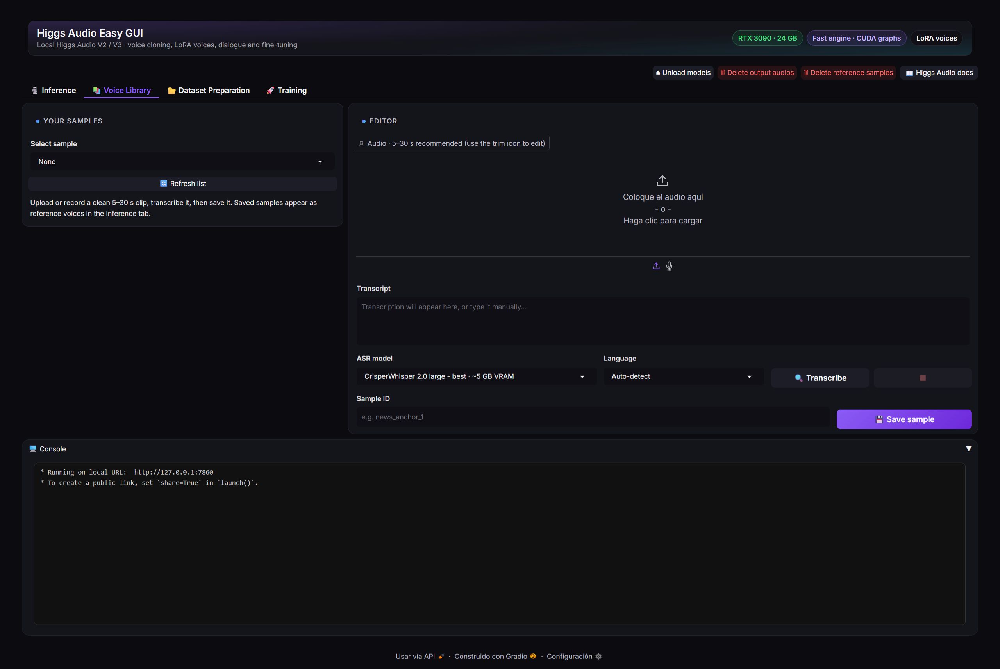
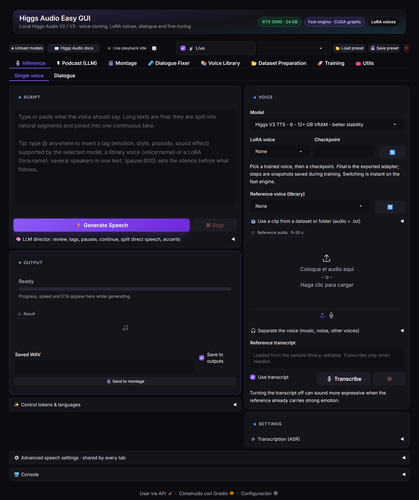
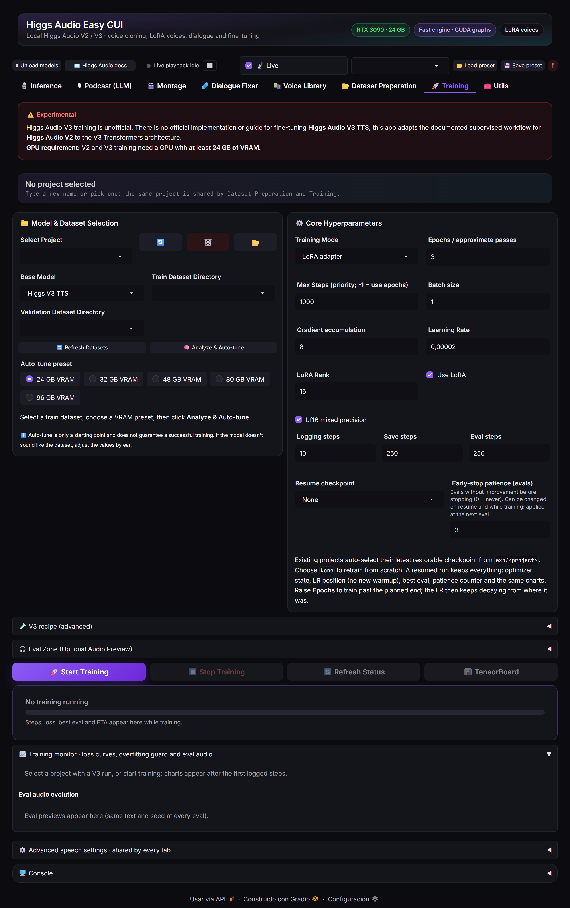

# 🗣️ Higgs Audio Easy GUI: Local TTS, Voice Cloning & LoRA Training

A polished Windows WebUI for **local Higgs Audio workflows**: reference voice preparation, fast Higgs V3 (and V2) speech generation, CrisperWhisper verbatim transcription, voice isolation + natural segmentation for datasets, and LoRA training with auto-tune, early stopping and a built-in training monitor.

---

## 🆕 What's new — 2026-11-20

### Inference
- **Fast Higgs V3 engine (bf16):** optimized PyTorch decoder with a static KV cache, CUDA graphs and on-GPU sampling. Same model math as the reference loop, several times faster, and no `torch.compile` warm-up needed. LoRA adapters are merged into the weights, so switching adapters is instant. 8-bit / 4-bit still use the slower compatibility engine.
- **Seamless long text:** Higgs V3 reads reliably for about 25 s (~300 characters) per pass, so longer text is split automatically at sentence boundaries and rendered back to back as one continuous take with a consistent voice.
- **Inference progress bar** (segments, frames, elapsed time). Streaming mode was removed.
- **Waveform player** is always visible and its playhead resets on each new generation.
- **Windows fixes:** inference no longer slows down when the console window loses focus (background throttling disabled, high-resolution timer, raised process priority). Console QuickEdit is turned off so a stray click can't freeze the app.
- **VRAM hygiene:** every model (TTS, fast-engine graphs, ASR) is unloaded before dataset building, training and transcription, so nothing lingers in VRAM.

### Interface
- Wider, responsive layout that uses the screen width (up to 2560 px) with tighter spacing.
- **LoRA discovery** grouped as *project → checkpoint* (Final, Best eval, and the steps of the current run only).

### ASR & datasets
- **CrisperWhisper 2.0** (large / turbo / medium / small) replaces faster-whisper: verbatim transcripts with language auto-detection.
- Dataset preparation now runs **Inworld Voice Isolator** (noise/music removal) and **Inworld SAVA** natural segmentation, plus loudness normalisation.

### Projects
- **Shared project management** between Dataset Preparation and Training (`projects/<name>/project.json`), with a project card showing the pipeline *Dataset → Training → Voice ready* and an 📂 open-folder button.
- The project 🔄 button reloads every field from disk, including the V3 recipe and resume checkpoints. When a training run ends, the resume list refreshes automatically.
- Training with **Resume = None** wipes the previous run of that project (keeping the audio-code cache), so the lists only show the current run.

### Training (Higgs V3)
- **Rewritten V3 trainer:** padded batches grouped by length with a cap on audio per micro-batch, warmup + cosine/linear/constant schedule, weight decay, optional gradient checkpointing, BOC-masked token loss with per-codebook stats, NaN-batch skipping and gradient-spike warnings.
- **Optimizers:** AdamW, **Prodigy** and **Prodigy Schedule-Free** (both Prodigy variants estimate the learning rate on their own).
- **Smart auto-tune:** analyses the dataset (minutes of speech, clip-length distribution, eval set, VRAM) and picks rank, batch × accumulation, LR, epoch budget, eval/save intervals, early-stop patience and gradient checkpointing, with an explanation and data-quality warnings. *It is only a starting point and does not guarantee success: if the voice doesn't sound like the dataset, adjust the values by ear.*
- **Anti-overfitting guard:** baseline eval of the untrained model, warm-up grace, early stop with patience / minimum improvement, stop when eval falls back below the base model, and warnings when eval rises or the train/eval gap widens. `checkpoint-best` is always saved and by default the **Final adapter = best eval**.
- **📈 Training monitor** (embedded, no TensorBoard needed): status cards, loss chart (train + eval, base line, best and stop markers), LR and gradient-norm charts, warnings, and an **eval audio evolution** panel — the same sentence and seed at every eval step, next to the real recording and the base model, with "best" and "did not stop" badges.
- **Training progress bar** in the same style as inference; the old text status was removed.

---

## ✨ Feature Overview

| Area | What it does |
| :--- | :--- |
| **Higgs V3 TTS** | Fast local inference (static KV cache + CUDA graphs) with seamless long-text rendering. |
| **Higgs V2 TTS** | Local Higgs V2 generation for legacy/experimental workflows. |
| **Reference Voice Library** | Save reusable voice samples and transcripts under `samples/`. |
| **LoRA Adapters** | Pick *project → checkpoint* (Final / Best eval / steps) from `exp/`; instant switching on the fast engine. |
| **Single Inference** | Generate speech from target text with optional reference audio and seed control. |
| **Dialogue Builder** | Build multi-speaker turns, assign voice references, and concatenate the final WAV. |
| **Long-Form / Batch** | Split long text by paragraph, period, line, or speaker turns, then join chunks. |
| **CrisperWhisper 2.0 ASR** | Verbatim transcription (numbers spelled out, repetitions kept) for references and datasets. |
| **Dataset Preparation** | Voice isolation + SAVA segmentation + ASR into train/eval datasets under `data/`. |
| **Training UI** | V3 LoRA training with auto-tune, Prodigy optimizers, early stopping and a built-in monitor (V2 also supported). |
| **Projects** | One project shared by Dataset and Training, with saved settings and a pipeline card. |
| **Local Storage Layout** | Models, cache, datasets, LoRAs, logs, samples, and outputs are organized by folder. |

---

## ⚠️ Higgs V3 Training Notice

**Higgs Audio V3 TTS training is experimental and unofficial.**

At the time this GUI was built, there is no official public Higgs V3 TTS fine-tuning guide or trainer equivalent to a mature supervised LoRA workflow. This app exposes an experimental V3 training path by adapting the available Higgs-style supervised workflow to the local V3 Transformers runtime.

The included V3 trainer uses teacher-forced cross entropy over delayed 8-codebook audio tokens. The following practical improvements were adapted from [tuanh123789/Higgs-tts-3-finetune](https://github.com/tuanh123789/Higgs-tts-3-finetune):

- **Audio-code cache:** target/reference WAV files are encoded once and cached under `exp/<project>/audio_code_cache`, so later epochs, eval passes, and resumed runs do not waste time re-tokenizing the same audio.

- **V3 audio module persistence:** `audio_embedding` and `audio_head` are saved beside `qwen3_lora` as `higgs_v3_audio_modules.pt` and restored during inference/resume when present. This can make inference more faithful to the training/eval sound, because the adapter is loaded with the same V3 audio helper layers that were present during training instead of only the Qwen LoRA weights. It does not guarantee higher quality in every case, but it reduces one source of mismatch between training eval and later inference.

---

## 🔄 Application Workflow

The GUI follows a complete local voice workflow:

### 1. 🎙️ Voice Library



Build a reusable reference voice library.

- Import or record short reference clips.
- Trim samples to a clean, stable range.
- Transcribe with CrisperWhisper 2.0 or write transcripts manually.
- Save paired audio/transcript samples to `samples/`.

Recommended reference clips are usually **5–30 seconds**, clean, single-speaker, and free of background music or overlapping voices.

---

### 2. 🗣️ Inference



Generate speech with Higgs V2 or V3.

- Select the TTS model.
- Optionally load a LoRA adapter.
- Select a saved voice sample or upload reference audio.
- Tune the desired parameters under advanced settings.
- Save generated WAV files under `outputs/`.

Long text is segmented automatically (~300 characters per pass) and joined seamlessly; a progress bar shows segments and frames while it renders.

---

### 3. 👥 Dialogue / Multi-Speaker


Create multi-turn generated conversations.

- Add, copy, or delete speaker rows.
- Assign a different voice sample per turn.
- Generate each turn independently.
- Join the final dialogue with configurable silence gaps.

This is useful for podcasts, demos, character testing, and comparing voice references.

---

### 4. 📚 Dataset Preparation


Prepare train/eval datasets from local audio folders. Pick or create a **project**: its settings are saved and shared with the Training tab.

- Supports common audio formats.
- Uses existing `.txt` or `.json` transcripts when available.
- Isolates the voice with [Inworld Voice Isolator](https://github.com/inworld-ai/voice-isolator) (noise and music removal).
- Cuts natural 2–15 s speech segments with [Inworld SAVA](https://github.com/inworld-ai/sava) and normalises loudness.
- Fills missing transcripts with CrisperWhisper 2.0 (verbatim).
- Writes prepared train/eval data under `data/`.
- Validates dataset structure before training.

---

### 5. 🧬 Training / LoRA



Train or resume LoRA projects.

- Select the project (🔄 reloads all its fields and checkpoints).
- Click **🧠 Analyze & Auto-tune** to get a plan for your dataset and VRAM.
- Optionally pick an optimizer (AdamW / Prodigy / Prodigy Schedule-Free) and anti-overfitting settings under **🧪 V3 recipe (advanced)**.
- Leave the Eval Zone text empty to use a sentence from the eval set (its real recording is shown for comparison).
- Start training and follow it in the progress bar and the **📈 Training monitor**; early stopping ends the run when eval stops improving.
- Resume from the current run's checkpoints, or use **Final** (= best eval) in Inference.
- Outputs, adapters, checkpoints, `metrics.jsonl` and eval audio are stored under `exp/<project>/`.

**Tips when the result isn't right** (auto-tune is a starting point, not a guarantee):

| Symptom | Try |
| :--- | :--- |
| Voice not close enough / generic | More epochs, higher rank, slightly higher LR (or Prodigy d_coef 1.5–2), more patience. |
| Artifacts, mumbling, skipped words, doesn't stop talking | Overfitted: earlier checkpoint, fewer epochs, lower LR (or d_coef 0.5), lower rank. |
| Previews vary a lot | Larger effective batch (more gradient accumulation). |

---

## 🛠️ Installation & Launch

This project uses `uv` for fast and reproducible dependency management.

### Clone the repository (or download as a .zip archive):

```
git clone https://github.com/Mixomo/Higgs_Audio_TTS_Easy_GUI.git

cd Higgs_Audio_TTS_Easy_GUI
```

### Install

Run from the project folder:

```bat
install.bat
```

The installer will:

1. Install `uv` if needed.
2. Create the local virtual environment.
3. Install non-Torch dependencies.
4. Install the selected PyTorch backend last.
5. Verify CUDA when a CUDA backend is selected.

### PyTorch Backend Options

| Option | Target |
| :--- | :--- |
| **Auto-detect NVIDIA / CPU** | Recommended first try. |
| **CUDA 11.8** | NVIDIA GTX 10xx / Pascal compatibility. |
| **CUDA 12.6** | NVIDIA RTX 20xx / 30xx. |
| **CUDA 12.8** | NVIDIA RTX 40xx / 50xx. |
| **CPU only** | Compatibility mode; slow for TTS/training. |
| **AMD DirectML** | Experimental Windows AMD path. |

### Launch

```bat
start.bat
```

Then open:

```text
http://127.0.0.1:7860
```

---

## ⚙️ Requirements & Hardware Guide

### Software

- Windows 10/11.
- Modern web browser.
- `uv` package manager.
- NVIDIA driver compatible with the selected CUDA backend.

### VRAM Estimates

| Task | Minimum | Recommended |
| :--- | :---: | :---: |
| **CrisperWhisper 2.0 ASR** | CPU or small GPU | ~5 GB VRAM for large, ~2.5 GB for turbo |
| **Higgs V2 inference** | 12 GB VRAM | 16 GB+ VRAM |
| **Higgs V3 inference** | 16 GB VRAM | 24 GB+ VRAM |
| **LoRA training** | 24 GB VRAM | 24 GB+ VRAM |

CPU mode is available for compatibility, but TTS inference and training are expected to be slow.

---

## 📁 Local Folder Layout

| Folder | Purpose |
| :--- | :--- |
| `models/` | Final downloaded model folders. |
| `models/.cache/` | `uv`, Hugging Face, Xet, Torch, temp, and runtime caches. |
| `samples/` | Reference voice samples and transcripts. |
| `outputs/` | Persisted generated WAV files. |
| `data/` | Prepared training datasets. |
| `projects/` | Project settings shared by Dataset and Training (`project.json`). |
| `exp/` | Training runs: LoRA adapters, checkpoints, `checkpoint-best`, metrics and eval audio. |
| `logs/` | App and training logs. |
| `config/` | Local UI settings. |

---

## 🎧 Supported Formats

### Audio

```text
.wav
.mp3
.flac
.ogg
.m4a
```

### Transcripts

```text
.txt
.json
```

For reference samples, use the same file stem:

```text
my_voice.wav
my_voice.txt
```

---

## 🧪 Runtime Notes

### Higgs V3 Generation

- The fast engine (bf16) is used by default; 8-bit / 4-bit fall back to the compatibility engine.
- Each pass covers ~25 s of speech; longer text is segmented automatically.
- Sampling is distributionally identical to the reference engine, but a given seed produces a different take than with the old engine.
- Lower temperature and top-p values usually improve stability.
- Fixed seeds help compare settings; random seeds can improve natural variation.

### RAS / Repetition-Aware Sampling (Higgs V2 only)

RAS helps reduce audio-token loops, repeated syllables, repeated silences, or stuck generation patterns.

Typical starting point:

```text
ras_win_len = 7
ras_win_max_num_repeat = 2
```

If generation loops, try lowering the repeat count. If speech becomes too clipped or unnatural, return to the default.

### Torch Compile

Only relevant for the **compatibility engine** (8-bit / 4-bit); the fast engine doesn't need it. There it can increase synthesis speed by up to 2.3x (NVIDIA GPU only).

- First generation can be slower (take up to 5 minutes) because kernels need warmup.
- Similar later generations can be significantly faster.
- Changing model, shape, reference pattern, LoRA adapter, or chunk layout can trigger new compile passes.
- Disable it if you prefer predictable speed over maximum throughput.

---

## 📊 RTX 3090 Compile Benchmark

Compatibility-engine Higgs V3 test on **NVIDIA GeForce RTX 3090**, same text, seed, and frame limit (measured before the fast engine existed).

```text
Max audio frames: 4096
Precision: auto -> bf16
Attention: SDPA
LoRA: none
Reference audio: none
```

| Mode | Load time | Frames | Audio length | Generation elapsed | RTF | Avg frames/s |
| :--- | ---: | ---: | ---: | ---: | ---: | ---: |
| `torch.compile` off | 8.37s | 525 | 20.7s | 21s | 1.01 | 24.95 |
| `torch.compile` on | 8.32s | 551 | 21.8s | 9s | 0.41 | 57.98 |

In this run, `torch.compile` was about **2.3× faster** during frame generation once active. First-time compilation can still take up to 5 minutes to warmup.

---

## 🧯 Troubleshooting

| Symptom | Suggested action |
| :--- | :--- |
| CUDA OOM during inference | Lower max frames, unload ASR, disable compile, use chunking, or try lower precision if supported. |
| Voice changes between chunks | Enable shared chunk seed, use shorter chunks, or reuse the same reference sample consistently. |
| Output skips words on long text | Keep automatic segmentation on; one pass reads reliably only ~25 s. |
| Inference slow with the console in background | Fixed on 2026-11-20; restart the app if it was started before updating. |
| First compile run seems frozen | Wait for kernel compilation; later runs with similar shapes should be faster. |
| ASR is slow | Use CrisperWhisper 2.0 turbo or small. |
| Training overfits quickly | Keep an eval set so early stopping works, use Final = best eval, lower LR / epochs, and use cleaner, more varied data. |

---

## 🙏 Credits

Built for local use around:

- [Boson AI Higgs Audio](https://github.com/boson-ai/higgs-audio)
- [Train Higgs Audio repo](https://github.com/JimmyMa99/train-higgs-audio)
- [tuanh123789/Higgs-tts-3-finetune](https://github.com/tuanh123789/Higgs-tts-3-finetune)
- [CrisperWhisper](https://github.com/nyrahealth/CrisperWhisper) (weights: non-commercial research license)
- [Prodigy](https://github.com/konstmish/prodigy) and [Prodigy Plus Schedule-Free](https://github.com/LoganBooker/prodigy-plus-schedule-free) optimizers
- [speech-studio](https://github.com/timoncool/speech-studio) (inspiration for the fast engine) and [Mixomo/Qwen_TTS_Easy_GUI](https://github.com/Mixomo/Qwen_TTS_Easy_GUI) (project management)
- [Inworld SAVA](https://github.com/inworld-ai/sava) and [Voice Isolator](https://github.com/inworld-ai/voice-isolator) (Apache-2.0)


GUI layout and workflow inspired by [FranckyB](https://github.com/FranckyB) [Voice Clone Studio](https://github.com/FranckyB/Voice-Clone-Studio)

---

## 📌 Project Scope

This GUI is a practical local workflow tool, not an official Boson AI release. Higgs model licenses and usage restrictions still apply. Review the upstream model licenses before distributing generated audio, fine-tunes, or derived model artifacts.
