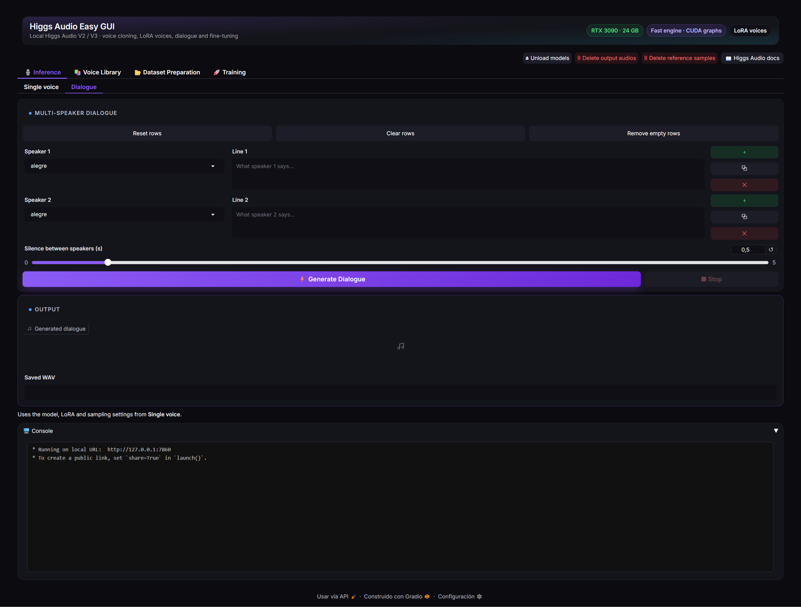
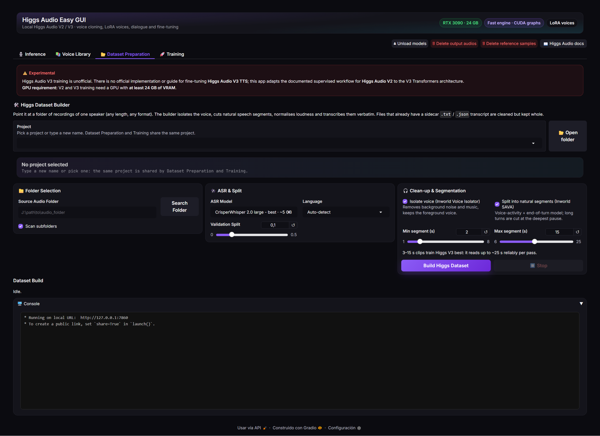
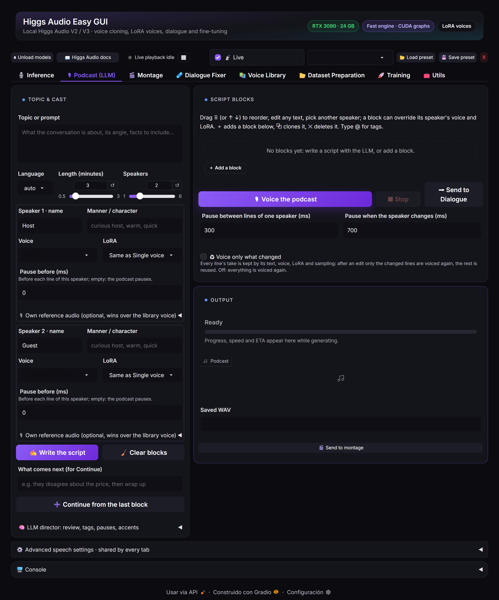
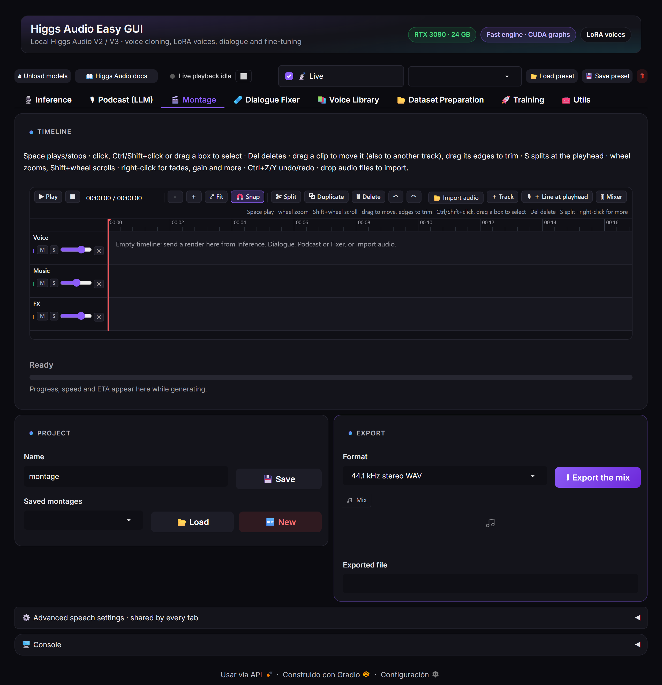
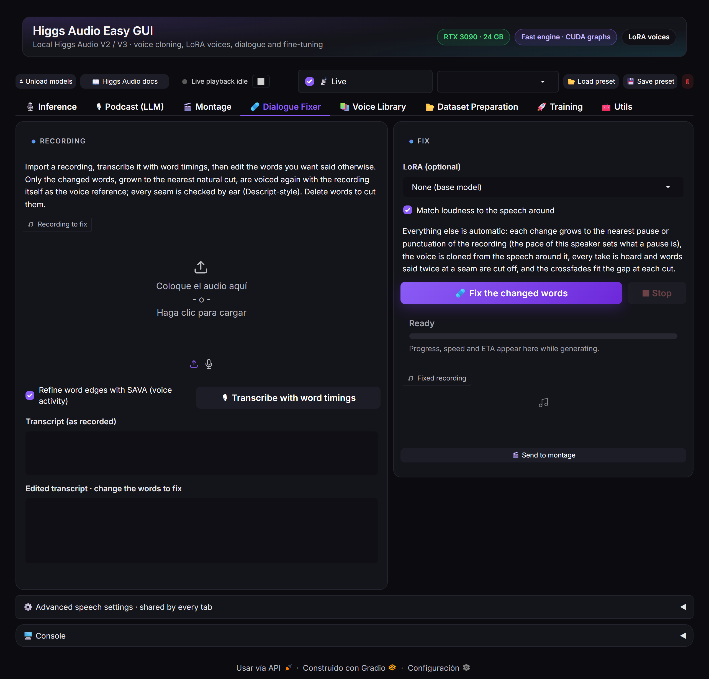
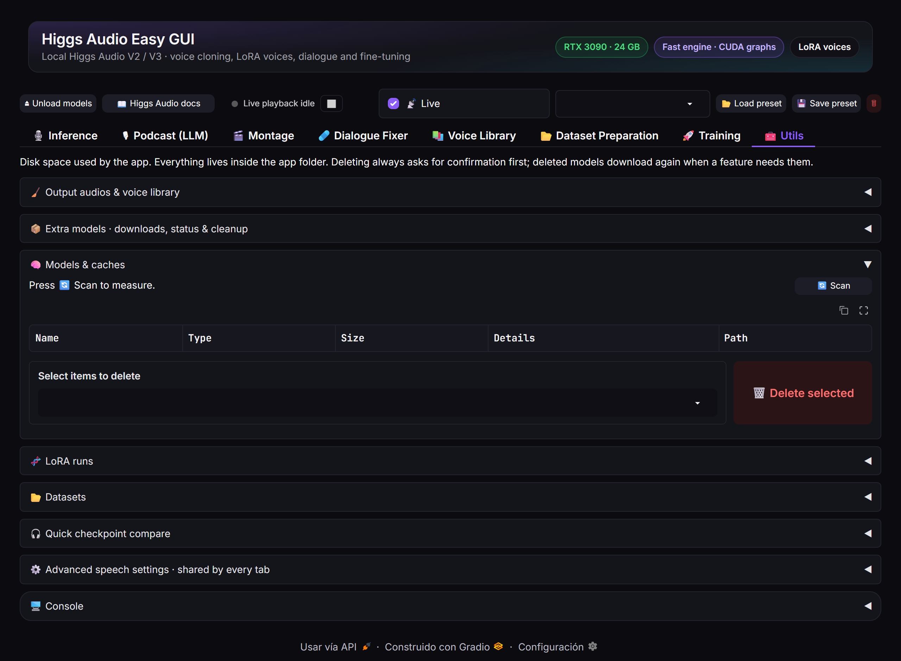

# 🗣️ Higgs Audio Easy GUI: Local TTS, Voice Cloning & LoRA Training

A polished Windows WebUI for **local Higgs Audio workflows**: reference voice preparation, fast Higgs V3 (and V2) speech generation, CrisperWhisper verbatim transcription, voice isolation + natural segmentation for datasets, and LoRA training with auto-tune, early stopping and a built-in training monitor.

---

## 🆕 What's new — 2026-11-27

### ▶️ Reference voices from YouTube
- **Inference** and the **Voice Library** editor have a **▶️ From YouTube** box: paste a link (YouTube or any site yt-dlp supports), optionally set **From** / **To** (empty: the link's `?t=` or the start, and up to the end) and **⬇ Download**. The whole video or just that part is downloaded, never cut to a fixed length, as mono WAV in `downloads/references`, and it becomes the reference audio, ready to trim, separate, transcribe and save (the Voice Library also suggests the Sample ID from the video title).
- **💾 Save to the voice library** in Inference: type a name and save the current reference (audio + transcript, as trimmed or separated) to `samples/`; it becomes the selected library voice. An existing name is never overwritten there.
- **Live plays in one window only:** the tab where you pressed the button plays the live audio; other tabs or browsers with the app open stay quiet ("playing in another window") instead of playing it again a few milliseconds apart, which sounded like a doubled voice.
- **Training clips of any length:** the V3 trainer no longer skips clips over 30 s. Training → V3 recipe → *Skip clips longer than* is 0 (no limit) by default, up to 600 s if you want a cap; auto-tune warns when the longest clip may not fit a micro-batch in VRAM.
- **References of any length:** nothing is cut to 30 s any more. ⚙️ Advanced → ⚗️ Runtime → *Reference length used* (0 = no limit, the default; up to 600 s) sets how much of a reference the model hears; the model's context holds about 20 minutes in total. A longer reference takes a little more time and VRAM.
- After **🎧 Separate**, the player always reloads with the clean voice, and the note says where it was saved (`outputs/cleaned_refs/`).
- **Default separation chain everywhere:** `voc_fv7 + gabox_denoise + becruily_karaoke` is preselected in Inference, the Voice Library, Dataset Preparation, Podcast speakers, Dialogue lines and the timeline line dialog.

### 📂 Datasets and training
- **Min / Max duration** sliders in Dataset Preparation go from 0 to 600 s. Raw audio: longer turns are split, shorter ones dropped.
- **Ready datasets keep their own lengths:** *Keep the dataset's own lengths (max = the longest clip)* is on by default: every clip is imported as it is, and the max shows the longest clip when the dataset is scanned. Switch it off to drop clips outside Min / Max duration (listed in the build report).
- **Training → Logging / Save / Eval epochs** next to their steps: save, evaluate or log every N epochs (0.5 = twice per epoch). 0 = use the steps. The V3 trainer turns them into steps at start and says so in the log.

### 🖥 The page
- **⚙️ Advanced speech settings** shows only on the tabs that make speech: hidden in the Voice Library, Dataset Preparation and Training.
- **Back where you were after a restart:** every browser tab saves its settings as they change (in `config/session/`, dropped after 3 days unused) and gets them back when that tab reloads, as it does after an app restart. A newly opened tab starts clean. Audio generated before the restart is not kept.
- **A tab left open across an update stays quiet:** if the app restarts with updated code and an old tab did not notice, that tab pauses (no more errors in the console) and shows a **⟳ Reload** button instead of reloading by force, so you can copy anything first.


### Speech engine: checks, retakes, live playback
- **⚙️ Advanced speech settings** (one panel shared by the tabs that make speech, above the console): quality presets (Draft / Standard / Optimal), sampling, long-text mode, seed, and new options:
  - **Check every take by ear** (CrisperWhisper WER with Strict / Normal / Lenient thresholds), **voice similarity** to the reference (WeSpeaker ResNet34 voice prints), takes per block and retries; the best take is kept.
  - **Sound checks** of every take: runaway / cut-off generation, silence, hum, clipping, little speech, long pauses, noise in pauses, whistle, repeated audio, loudness.
  - **Pauses** between lines of the same / another speaker, **even pauses**, **even loudness**, **room tone** instead of digital silence, final loudness target.
  - **Numbers, years, times, money, ordinals and percent read as words** in the speech language (num2words).
  - **✨ Enhance voice (LavaSR):** restores the high frequencies above 12 kHz and saves at 48 kHz; optional denoise first.
  - **Live playback:** the audio plays while it is generated, seamlessly, in the background (no second player). Switch it off with **📡 Live** in the top bar (or in Advanced → Live playback & speed): no streaming, and the result plays by itself when it is done.
  - **♻ Voice only what changed** (in Dialogue and Podcast, off by default): after an edit, only the changed lines are voiced again; everything else comes from the take cache.
- **💾 GUI presets** (top right): save every setting and selection of the page under a name and load it back. Anything that is gone since (a reference audio, a library voice, a LoRA, a model) is skipped and reported; the rest loads.

### 🔊 One loudness everywhere
- A single internal normalizer (EBU R128, **−20 LUFS** by default, peaks under −1 dB) for every audio of the app: the files themselves: references used to generate (normalized in place once, when first used), the whole voice library (at startup and when saving), separated voices, every block (also the clips sent to the montage), the final audio of Single voice, Dialogue, Podcast, the timeline lines and its export, the Dialogue Fixer result and the dataset clips. Switch and target in ⚙️ Advanced → Pauses & finishing; an explicit *Final loudness* delivery target still wins.

### ⏸ Pauses per speaker and per line
- **Dialogue:** every line has its own *Pause before (ms)* (empty: the usual same / other speaker pause). **Podcast:** every speaker has a *Pause before (ms)* for all its lines. **Anywhere:** a `{pause:800}` tag (also `1.5s`) sets the silence before what follows; the @ autocomplete offers it.

### 🎚 Timeline mixer
- **🎚 Mixer** opens one channel strip per track: volume fader with dB (double-click: 0 dB), pan (double-click: centre), mute / solo and a live level meter, plus a master meter. Changes are heard live while playing, and the export uses the same volume and pan law, brought as a whole to the app's loudness.

### 🗣 Several voices in one text
- Type **@** in any text box: besides the expression tags, the autocomplete lists your **library voices** (`{voice:name}`) and **LoRAs** (`{lora:name}`, `{lora:none}`). A tag switches the speaker from there on, so a single Inference text can hold a whole conversation; in Dialogue lines, Podcast blocks and the timeline it switches inside that line.

### 🎧 Voice separation for references
- In **Inference** (reference audio), the **Voice Library** editor, every **Dialogue** line's own reference, each **Podcast** speaker (new: own reference audio per speaker) and the **timeline** line dialog (new: own reference audio): separate the voice from music, noise or other voices with any RoFormer model or chain (voc_fv7, gabox, becruily deux, karaoke and their combinations, or the Inworld isolator); **↩ Original** brings the clip back.

### Dialogue
- **No row limit:** the Dialogue builder takes any number of lines, reordered by drag and drop. Each line has its own library voice **or its own reference audio** (with transcript) and **its own LoRA**; ＋ / ⧉ carry them to the new line.

### 🧠 LLM director (local llama.cpp or any OpenAI-compatible server such as LM Studio)
- Local GGUF models (Gemma 4 12B quants, downloaded with checksum on first use) or a server with **🔌 Check remote connection**; **⏏ Unload LLM** and *share the GPU* (speech models leave the GPU while the LLM runs, the LLM stops before voicing).
- In Inference, Dialogue, Podcast and the timeline: **review the script**, **add tags**, **punctuate for pauses**, **continue the script**, **split direct speech** into dialogue lines, **put back accents** (tildes, ё). Answers that change words where they must not are refused line by line.

### 🎙 Podcast (LLM) tab (new)
- Topic, language, length and up to 6 speakers (name, manner, voice, LoRA). The LLM writes the script as editable blocks (drag to reorder, per-block voice / LoRA override) and keeps writing until the asked length is reached; **continue from the last block** with a direction.
- The script is written without its ending, continued until the asked length and closed once at the end (no repeated goodbyes).
- Own pauses between lines of one speaker and on a speaker change. Voice it, send it to Dialogue or to the montage.

### 🎬 Montage tab (new)
- Multi-track timeline (voices, music, FX): move across tracks, trim, split, duplicate, fades and gain, mute / solo, click / Ctrl / Shift / box selection, Del, wheel zoom, undo / redo, audio import by file or drag and drop, autosave, save / load projects, 24-bit WAV export.
- **🎙 Add a dialogue line at the playhead** (or right-click → *here*): pick voice, LoRA and text in a dialog with all LLM tools; **double-click a clip** to edit its text, voice and LoRA and voice it again (later clips of the track can shift by the change in length).
- Every tab has **🎬 Send to montage**, which asks whether to append to the timeline or clear it first.

### 🩹 Dialogue Fixer tab (new)
- Import a recording, transcribe it with word timings (CrisperWhisper, word edges refined with SAVA), edit the words, and only the changed words are voiced again with the recording itself as the voice reference, matched in loudness and spliced with crossfades.
- **Nothing to tune by hand:** each change grows by itself to the nearest punctuation mark or pause (what counts as a pause comes from the speaker's own pace) and to enough words for a natural intonation. Words that are only taken out are cut cleanly when there is air around them. The reference length and the crossfade at each cut (short in a silence, longer inside running speech) are chosen automatically too. While you edit, the tab shows which spans will be voiced again.
- **No word said twice:** every take is heard by ASR and voiced again if it is wrong. Then it is aligned to its text, and any word it says beyond the text at an edge (typically a word of the reference said again) is cut off before the splice.
- **Every seam checked by ear:** word timings are often a few tens of ms off. A cut that clips a neighbouring word or leaves part of the old one is caught by listening to a short window around the seam, and the cut moves until it sounds right. A seam that never does is marked *unsure* in the report.
- Live playback is always off in the fixer: the fixed recording plays when it is done.

### Training & Utils
- **Keep only the best model:** no numbered checkpoints are written; the best eval adapter (a few MB) becomes the final LoRA. Saves disk; such a run can't be resumed.
- **📦 Extra models** in Utils: status, download and delete of the voice print model, llama.cpp, the LLM GGUFs and LavaSR.

---

## What's new — 2026-11-22

### Inference
- **@ tag autocomplete:** type `@` anywhere in the script (also dialogue lines and the checkpoint-compare text) to open the tags the selected model supports — V3 emotions, styles, prosody and sound effects (`<|sfx:laughter|>Haha` comes with its sound word), or V2 events like `[laugh]` / `[music start]`. Keep typing to filter (`@sad`, `@sfx:cough`), ↑/↓ to move, Enter/Tab to insert, Esc to close.
- **Steady delivery across segments:** when the text is split, sentence-level V3 tags (emotion, style, environment, speed / pitch / expressiveness) carry over to the following segments, so the intonation doesn't drift back to neutral after a split. Tags written later add up and only replace the previous tag of the same kind; sound effects and pauses are never repeated, and Speaker turns keep only their own tags. On by default; turn it off with **Carry tags across segments** (next to the long-text mode). The Dialogue builder follows the same switch: tags carry between the chunks of one line, and each line keeps its own tags.
- **Player fixes:** long audio no longer hides the time labels under the waveform's scrollbar (now a thin bar below the waveform), and the finished-generation summary shows the audio length in minutes (e.g. `15:47 min`).
- **Reference clips from any dataset:** Inference and Voice Library have a 📥 importer that lists every Higgs dataset split (`data/<project>/train|eval`) or any folder with audio + `.txt` pairs (`metadata.jsonl` also works), searchable by name, length and text. A file picker loads a single audio file from anywhere together with its `.txt` (found automatically, or picked alongside it).

### 🧰 Utils tab (new)
- **Disk usage** of every downloaded model and cache, LoRA run and dataset (size per item and total), with delete-after-confirmation. Items in use by a running training can't be deleted.
- **Checkpoint management** per LoRA run, plus **⭐ Keep only best** (removes the numbered checkpoints; `checkpoint-best` and the final adapter stay).
- **🎧 Quick checkpoint compare:** pick a LoRA run, select any or all of its checkpoints, type a custom sentence and generate it on each one with the same voice, seed and temperature; the results play side by side and are saved in `exp/<run>/checkpoint_compare/`.

### Datasets
- **YouTube as dataset input** (yt-dlp): paste videos, playlists or channels (one per line, optional `1:20-5:00` section). The audio is downloaded to `downloads/<project>` and then cleaned, segmented and transcribed like any raw recording. ffmpeg (imageio-ffmpeg) and the JavaScript runtime YouTube needs (deno) are bundled, so nothing has to be installed on the system. Only use content you have the rights to train on.
- **Import ready datasets:** point to a folder or `.zip` of audio + `.txt` pairs (e.g. `R:\dataset`). An optional `metadata.jsonl` is used when present (text, `keep` flag and train/eval split); `metadata.csv` (LJSpeech style) also works, and `LICENSE*` / `.md` notes are copied along. Optional clean-up per clip: separation engine, SAVA voice-activity edge trim (never cuts inside the text), dropping clips with too little speech, and loudness normalisation.
- **Text-to-audio alignment** (Qwen3-ForcedAligner 0.6B): optional final step for both raw recordings and ready datasets. Every word of each transcript is placed in time; clips are trimmed to the first / last spoken word, and clips whose text does not match the audio (wrong, partial or shifted transcripts) can be dropped automatically. 11 languages (es, en, fr, de, it, pt, ru, ja, ko, zh, yue); the model downloads once into `models/qwen3-forced-aligner-0.6b`.

### Training
- **Seamless training resume:** a resumed run keeps its full state — optimizer (incl. Prodigy's d and Schedule-Free weights), LR position without a new warmup, best eval, patience counter, loss average and preview sentence. Raising Epochs continues the decay from the current LR instead of restarting the cosine. Resuming from an earlier checkpoint discards the later branch (metrics and `checkpoint-best`), so charts and status read as one run with a "resumed" marker.
- **Editable patience:** early-stop patience sits next to the resume selector and can be changed on resume or live while training (applied at the next eval).

---

## What's new — 2026-11-20

### Inference
- **Fast Higgs V3 engine (bf16):** optimized PyTorch decoder with a static KV cache, CUDA graphs and on-GPU sampling. Same model math as the reference loop, several times faster, and no `torch.compile` warm-up needed. LoRA adapters are merged into the weights, so switching adapters is instant. 8-bit / 4-bit still use the slower compatibility engine.
- **Seamless long text:** Higgs V3 reads reliably for about 25 s (~300 characters) per pass, so longer text is split automatically at sentence boundaries and rendered back to back as one continuous take with a consistent voice.
- **Inference progress bar** (segments, frames, elapsed time). Streaming mode was removed.
- **Waveform player** is always visible and its playhead resets on each new generation.
- **Windows fixes:** inference no longer slows down when the console window loses focus (background throttling disabled, high-resolution timer, raised process priority). Console QuickEdit is turned off so a stray click can't freeze the app.
- **VRAM hygiene:** every model (TTS, fast-engine graphs, ASR) is unloaded before dataset building, training and transcription, so nothing lingers in VRAM.

### Interface
- Wider, responsive layout that uses the screen width (up to 2560 px) with tighter spacing.
- **LoRA discovery** grouped as *project → checkpoint* (Final, Best eval, and the steps of the current run only).

### ASR & datasets
- **CrisperWhisper 2.0** (large / turbo / medium / small) replaces faster-whisper: verbatim transcripts with language auto-detection.
- Dataset preparation now runs **Inworld Voice Isolator** (noise/music removal) and **Inworld SAVA** natural segmentation, plus loudness normalisation.
- **Voice clean-up engines**: Inworld Voice Isolator or Mel-Band / BS-RoFormer models (voc_fv7, gabox denoise, becruily deux, becruily karaoke), alone or chained. RoFormer checkpoints download once into `models/mss`.

### Projects
- **Shared project management** between Dataset Preparation and Training (`projects/<name>/project.json`), with a project card showing the pipeline *Dataset → Training → Voice ready* and an 📂 open-folder button.
- The project 🔄 button reloads every field from disk, including the V3 recipe and resume checkpoints. When a training run ends, the resume list refreshes automatically.
- Training with **Resume = None** wipes the previous run of that project (keeping the audio-code cache), so the lists only show the current run.

### Training (Higgs V3)
- **Rewritten V3 trainer:** padded batches grouped by length with a cap on audio per micro-batch, warmup + cosine/linear/constant schedule, weight decay, optional gradient checkpointing, BOC-masked token loss with per-codebook stats, NaN-batch skipping and gradient-spike warnings.
- **Optimizers:** AdamW, **Prodigy** and **Prodigy Schedule-Free** (both Prodigy variants estimate the learning rate on their own).
- **Smart auto-tune:** analyses the dataset (minutes of speech, clip-length distribution, eval set, VRAM) and picks rank, batch × accumulation, LR, epoch budget, eval/save intervals, early-stop patience and gradient checkpointing, with an explanation and data-quality warnings. *It is only a starting point and does not guarantee success: if the voice doesn't sound like the dataset, adjust the values by ear.*
- **Anti-overfitting guard:** baseline eval of the untrained model, warm-up grace, early stop with patience / minimum improvement, stop when eval falls back below the base model, and warnings when eval rises or the train/eval gap widens. `checkpoint-best` is always saved and by default the **Final adapter = best eval**.
- **📈 Training monitor** (embedded, no TensorBoard needed): status cards, loss chart (train + eval, base line, best and stop markers), LR and gradient-norm charts, warnings, and an **eval audio evolution** panel — the same sentence and seed at every eval step, next to the real recording and the base model, with "best" and "did not stop" badges.
- **Training progress bar** in the same style as inference; the old text status was removed.

---

## ✨ Feature Overview

| Area | What it does |
| :--- | :--- |
| **Higgs V3 TTS** | Fast local inference (static KV cache + CUDA graphs) with seamless long-text rendering. |
| **Higgs V2 TTS** | Local Higgs V2 generation for legacy/experimental workflows. |
| **Reference Voice Library** | Save reusable voice samples and transcripts under `samples/`. |
| **LoRA Adapters** | Pick *project → checkpoint* (Final / Best eval / steps) from `exp/`; instant switching on the fast engine. |
| **Single Inference** | Generate speech from target text with optional reference audio and seed control. |
| **Dialogue Builder** | Multi-speaker turns, each with its own voice, LoRA, reference and pause; only the changed lines are voiced again. |
| **Several voices in one text** | `{voice:name}`, `{lora:name}` and `{pause:800}` tags (with `@` autocomplete) switch speaker, LoRA or silence inside one Single inference. |
| **Podcast (LLM)** | A local LLM (llama.cpp, or any OpenAI-compatible server) writes a podcast for your cast; edit the blocks and voice it. |
| **Montage** | Multi-track timeline: move, trim, split, fade, voice new lines in place, a mixer with faders, pan and meters, export the mix. |
| **Dialogue Fixer** | Edit the transcript of a recording and only the changed words are voiced again, cloned from the recording itself. |
| **Voice separation** | Clean any reference (voice from music, noise or other voices) in Inference, the Voice Library, Dialogue, Podcast and the timeline. |
| **One loudness** | Every reference, sample, dataset clip and output at the same loudness (LUFS), so nothing is louder than the rest. |
| **Long-Form / Batch** | Split long text by paragraph, period, line, or speaker turns, then join chunks. |
| **CrisperWhisper 2.0 ASR** | Verbatim transcription (numbers spelled out, repetitions kept) for references and datasets. |
| **Dataset Preparation** | Voice isolation + SAVA segmentation + ASR into train/eval datasets under `data/`. |
| **Training UI** | V3 LoRA training with auto-tune, Prodigy optimizers, early stopping and a built-in monitor (V2 also supported). |
| **Projects** | One project shared by Dataset and Training, with saved settings and a pipeline card. |
| **Utils** | Disk use, extra models, LoRA runs, datasets, output / library cleanup and a quick checkpoint compare. |
| **Local Storage Layout** | Models, cache, datasets, LoRAs, logs, samples, and outputs are organized by folder. |

---

## ⚠️ Higgs V3 Training Notice

**Higgs Audio V3 TTS training is experimental and unofficial.**

At the time this GUI was built, there is no official public Higgs V3 TTS fine-tuning guide or trainer equivalent to a mature supervised LoRA workflow. This app exposes an experimental V3 training path by adapting the available Higgs-style supervised workflow to the local V3 Transformers runtime.

The included V3 trainer uses teacher-forced cross entropy over delayed 8-codebook audio tokens. The following practical improvements were adapted from [tuanh123789/Higgs-tts-3-finetune](https://github.com/tuanh123789/Higgs-tts-3-finetune):

- **Audio-code cache:** target/reference WAV files are encoded once and cached under `exp/<project>/audio_code_cache`, so later epochs, eval passes, and resumed runs do not waste time re-tokenizing the same audio.

- **V3 audio module persistence:** `audio_embedding` and `audio_head` are saved beside `qwen3_lora` as `higgs_v3_audio_modules.pt` and restored during inference/resume when present. This can make inference more faithful to the training/eval sound, because the adapter is loaded with the same V3 audio helper layers that were present during training instead of only the Qwen LoRA weights. It does not guarantee higher quality in every case, but it reduces one source of mismatch between training eval and later inference.

---

## 🔄 Application Workflow

The GUI follows a complete local voice workflow:

### 1. 🎙️ Voice Library


Build a reusable reference voice library.

- Import or record short reference clips, or download a YouTube video, whole or a part (▶️ From YouTube: link, optional From / To).
- Trim samples to a clean, stable range.
- Transcribe with CrisperWhisper 2.0 or write transcripts manually.
- Save paired audio/transcript samples to `samples/`.

Recommended reference clips are usually **5–30 seconds**, clean, single-speaker, and free of background music or overlapping voices.

---

### 2. 🗣️ Inference


Generate speech with Higgs V2 or V3.

- Select the TTS model.
- Optionally load a LoRA adapter.
- Select a saved voice sample or upload reference audio.
- Tune the desired parameters under advanced settings.
- Save generated WAV files under `outputs/`.

Long text is segmented automatically (~300 characters per pass) and joined seamlessly; a progress bar shows segments and frames while it renders.

Sentence-level tags (emotion, style, speed / pitch / expressiveness) carry over to the following segments so the delivery doesn't drift back to neutral after a split; tags written later add up, replacing only the previous tag of the same kind (a new emotion replaces the old emotion, the rest stays) (Speaker turns keep only their own tags).

Type `@` anywhere in the script to pick a tag supported by the selected model (emotion, style, prosody, sound effect for V3; events for V2).

---

### 3. 👥 Dialogue / Multi-Speaker



Create multi-turn generated conversations.

- Add, copy, reorder or delete lines.
- Give every line its own library voice or reference audio (with voice separation), its own LoRA and its own pause before it.
- **♻ Voice only what changed:** after an edit, only the changed lines are voiced again.
- Join the final dialogue with the pauses you set (same speaker / speaker change), and send it to the 🎬 Montage.

This is useful for podcasts, demos, character testing, and comparing voice references.

---

### 4. 📚 Dataset Preparation



Prepare train/eval datasets from local audio folders. Pick or create a **project**: its settings are saved and shared with the Training tab.

- Supports common audio formats.
- Uses existing `.txt` or `.json` transcripts when available.
- **Three sources:** 🎙️ raw recordings, ▶️ YouTube links via [yt-dlp](https://github.com/yt-dlp/yt-dlp) (both segmented and transcribed) or 📦 a ready dataset (folder or `.zip` of audio + `.txt`, optional `metadata.jsonl`).
- Cleans the voice with [Inworld Voice Isolator](https://github.com/inworld-ai/voice-isolator) or Mel-Band / BS-RoFormer separation (music, noise, background voices), alone or chained.
- Cuts natural 2–15 s speech segments with [Inworld SAVA](https://github.com/inworld-ai/sava) and normalises loudness (ready datasets: optional SAVA edge trim and low-speech filter).
- Fills missing transcripts with CrisperWhisper 2.0 (verbatim).
- Optionally aligns every transcript to its audio with [Qwen3-ForcedAligner](https://huggingface.co/Qwen/Qwen3-ForcedAligner-0.6B-hf): tight clip edges and automatic removal of clips whose text does not match.
- Writes prepared train/eval data under `data/`.
- Validates dataset structure before training.

---

### 5. 🧬 Training / LoRA


Train or resume LoRA projects.

- Select the project (🔄 reloads all its fields and checkpoints).
- Click **🧠 Analyze & Auto-tune** to get a plan for your dataset and VRAM.
- Optionally pick an optimizer (AdamW / Prodigy / Prodigy Schedule-Free) and anti-overfitting settings under **🧪 V3 recipe (advanced)**.
- Leave the Eval Zone text empty to use a sentence from the eval set (its real recording is shown for comparison).
- Start training and follow it in the progress bar and the **📈 Training monitor**; early stopping ends the run when eval stops improving.
- Resume from the current run's checkpoints, or use **Final** (= best eval) in Inference.
- Outputs, adapters, checkpoints, `metrics.jsonl` and eval audio are stored under `exp/<project>/`.
- To pick the best checkpoint by ear, use **🧰 Utils → 🎧 Quick checkpoint compare**; to free disk space, **⭐ Keep only best** in the same tab.

**Tips when the result isn't right** (auto-tune is a starting point, not a guarantee):

| Symptom | Try |
| :--- | :--- |
| Voice not close enough / generic | More epochs, higher rank, slightly higher LR (or Prodigy d_coef 1.5–2), more patience. |
| Artifacts, mumbling, skipped words, doesn't stop talking | Overfitted: earlier checkpoint, fewer epochs, lower LR (or d_coef 0.5), lower rank. |
| Previews vary a lot | Larger effective batch (more gradient accumulation). |

---

### 6. 🎙 Podcast (LLM)



Write and voice a whole podcast.

- Give a topic, the length and the cast: every speaker has a name, a manner, a library voice or own reference audio, a LoRA and a pause before their lines.
- **✍ Write the script:** the local LLM writes the conversation to the length you asked, saving the goodbyes for the end; **➕ Continue** adds what comes next.
- Every block can be edited, reordered, cloned, given another speaker or its own voice and LoRA; type `@` for tags and pauses.
- The **🧠 LLM director** reviews the script and adds tags, pauses and accents.
- **🎙 Voice the podcast** (only the changed blocks with ♻), or send it to Dialogue or to the Montage.

---

### 7. 🎬 Montage



Put everything together on a multi-track timeline.

- Clips from every tab (🎬 *Send to montage*) or imported audio, on voice, music and FX tracks.
- Move, trim, split, duplicate, fade and change gain; snap, zoom, undo / redo and a right-click menu.
- **🎙 Line at playhead:** write a line, pick the voice (or a reference of its own, with separation) and it is voiced in place; edit a clip's text to voice it again.
- **🎚 Mixer:** a fader, pan, mute / solo and a level meter per track, applied live and in the export.
- Save / load montages and export the mix (44.1 / 48 kHz stereo or 24 kHz mono WAV) at the app's loudness.

---

### 8. 🩹 Dialogue Fixer



Correct a recording by editing its words, Descript-style.

- Import or record the audio and **transcribe it with word timings** (CrisperWhisper, edges refined with SAVA).
- Edit the transcript: change, add or delete words. While you type, the tab shows which spans will be voiced again.
- Each change grows by itself to a natural cut; it is voiced with the recording itself as the reference, checked by ear (no word said twice, no word clipped at a seam) and spliced in at the recording's loudness.

---

### 9. 🧰 Utils



Housekeeping in one place; deleting always asks first.

- **🧹 Output audios & voice library:** empty the outputs folder or the voice library.
- **📦 Extra models:** status, download and cleanup of the optional models (voice similarity, local LLM engine and models, LavaSR enhancer).
- **🧠 Models & caches**, **🧬 LoRA runs** and **📂 Datasets:** what uses the disk, with sizes, and deletion of what you pick.
- **🎧 Quick checkpoint compare:** the same text, voice and seed on several checkpoints of a LoRA, to hear them side by side.

---

## 🛠️ Installation & Launch

This project uses `uv` for fast and reproducible dependency management.

### Clone the repository (or download as a .zip archive):

```
git clone https://github.com/Mixomo/Higgs_Audio_TTS_Easy_GUI.git

cd Higgs_Audio_TTS_Easy_GUI
```

### Install

Run from the project folder:

```bat
install.bat
```

The installer will:

1. Install `uv` if needed.
2. Create the local virtual environment.
3. Install non-Torch dependencies.
4. Install the selected PyTorch backend last.
5. Verify CUDA when a CUDA backend is selected.

### PyTorch Backend Options

| Option | Target |
| :--- | :--- |
| **Auto-detect NVIDIA / CPU** | Recommended first try. |
| **CUDA 11.8** | NVIDIA GTX 10xx / Pascal compatibility. |
| **CUDA 12.6** | NVIDIA RTX 20xx / 30xx. |
| **CUDA 12.8** | NVIDIA RTX 40xx / 50xx. |
| **CPU only** | Compatibility mode; slow for TTS/training. |
| **AMD DirectML** | Experimental Windows AMD path. |

### Launch

```bat
start.bat
```

Then open:

```text
http://127.0.0.1:7860
```

---

## ⚙️ Requirements & Hardware Guide

### Software

- Windows 10/11.
- Modern web browser.
- `uv` package manager.
- NVIDIA driver compatible with the selected CUDA backend.

### VRAM Estimates

| Task | Minimum | Recommended |
| :--- | :---: | :---: |
| **CrisperWhisper 2.0 ASR** | CPU or small GPU | ~5 GB VRAM for large, ~2.5 GB for turbo |
| **Higgs V2 inference** | 12 GB VRAM | 16 GB+ VRAM |
| **Higgs V3 inference** | 16 GB VRAM | 24 GB+ VRAM |
| **LoRA training** | 24 GB VRAM | 24 GB+ VRAM |

CPU mode is available for compatibility, but TTS inference and training are expected to be slow.

---

## 📁 Local Folder Layout

| Folder | Purpose |
| :--- | :--- |
| `models/` | Final downloaded model folders. |
| `models/.cache/` | `uv`, Hugging Face, Xet, Torch, temp, and runtime caches. |
| `samples/` | Reference voice samples and transcripts. |
| `outputs/` | Persisted generated WAV files. |
| `data/` | Prepared training datasets. |
| `projects/` | Project settings shared by Dataset and Training (`project.json`). |
| `exp/` | Training runs: LoRA adapters, checkpoints, `checkpoint-best`, metrics and eval audio. |
| `logs/` | App and training logs. |
| `config/` | Local UI settings. |

---

## 🎧 Supported Formats

### Audio

```text
.wav
.mp3
.flac
.ogg
.m4a
```

### Transcripts

```text
.txt
.json
```

For reference samples, use the same file stem:

```text
my_voice.wav
my_voice.txt
```

---

## 🧪 Runtime Notes

### Higgs V3 Generation

- The fast engine (bf16) is used by default; 8-bit / 4-bit fall back to the compatibility engine.
- Each pass covers ~25 s of speech; longer text is segmented automatically.
- Sampling is distributionally identical to the reference engine, but a given seed produces a different take than with the old engine.
- Lower temperature and top-p values usually improve stability.
- Fixed seeds help compare settings; random seeds can improve natural variation.

### RAS / Repetition-Aware Sampling (Higgs V2 only)

RAS helps reduce audio-token loops, repeated syllables, repeated silences, or stuck generation patterns.

Typical starting point:

```text
ras_win_len = 7
ras_win_max_num_repeat = 2
```

If generation loops, try lowering the repeat count. If speech becomes too clipped or unnatural, return to the default.

### Torch Compile

Only relevant for the **compatibility engine** (8-bit / 4-bit); the fast engine doesn't need it. There it can increase synthesis speed by up to 2.3x (NVIDIA GPU only).

- First generation can be slower (take up to 5 minutes) because kernels need warmup.
- Similar later generations can be significantly faster.
- Changing model, shape, reference pattern, LoRA adapter, or chunk layout can trigger new compile passes.
- Disable it if you prefer predictable speed over maximum throughput.

---

## 📊 RTX 3090 Compile Benchmark

Compatibility-engine Higgs V3 test on **NVIDIA GeForce RTX 3090**, same text, seed, and frame limit (measured before the fast engine existed).

```text
Max audio frames: 4096
Precision: auto -> bf16
Attention: SDPA
LoRA: none
Reference audio: none
```

| Mode | Load time | Frames | Audio length | Generation elapsed | RTF | Avg frames/s |
| :--- | ---: | ---: | ---: | ---: | ---: | ---: |
| `torch.compile` off | 8.37s | 525 | 20.7s | 21s | 1.01 | 24.95 |
| `torch.compile` on | 8.32s | 551 | 21.8s | 9s | 0.41 | 57.98 |

In this run, `torch.compile` was about **2.3× faster** during frame generation once active. First-time compilation can still take up to 5 minutes to warmup.

---

## 🧯 Troubleshooting

| Symptom | Suggested action |
| :--- | :--- |
| CUDA OOM during inference | Lower max frames, unload ASR, disable compile, use chunking, or try lower precision if supported. |
| Voice changes between chunks | Enable shared chunk seed, use shorter chunks, or reuse the same reference sample consistently. |
| Output skips words on long text | Keep automatic segmentation on; one pass reads reliably only ~25 s. |
| Inference slow with the console in background | Fixed on 2026-11-20; restart the app if it was started before updating. |
| First compile run seems frozen | Wait for kernel compilation; later runs with similar shapes should be faster. |
| ASR is slow | Use CrisperWhisper 2.0 turbo or small. |
| Training overfits quickly | Keep an eval set so early stopping works, use Final = best eval, lower LR / epochs, and use cleaner, more varied data. |

---

## 🙏 Credits

Built for local use around:

- [Boson AI Higgs Audio](https://github.com/boson-ai/higgs-audio)
- [Train Higgs Audio repo](https://github.com/JimmyMa99/train-higgs-audio)
- [tuanh123789/Higgs-tts-3-finetune](https://github.com/tuanh123789/Higgs-tts-3-finetune)
- [CrisperWhisper](https://github.com/nyrahealth/CrisperWhisper) (weights: non-commercial research license)
- [Prodigy](https://github.com/konstmish/prodigy) and [Prodigy Plus Schedule-Free](https://github.com/LoganBooker/prodigy-plus-schedule-free) optimizers
- [Speech Studio](https://github.com/timoncool/speech-studio) by Nerual Dreming (timoncool), MIT License: inspiration for the fast engine, and the design this release ports to Python: take checks and retakes (defect guard, sound flags, WER thresholds, quality presets), voice-print similarity, pauses / room tone / loudness finishing, live playback, the LLM director prompts and recommended Gemma quants, the podcast writer and the montage timeline ideas (see its [issue #36](https://github.com/timoncool/speech-studio/issues/36))
- [Mixomo/Qwen_TTS_Easy_GUI](https://github.com/Mixomo/Qwen_TTS_Easy_GUI) (project management)
- [LavaSR](https://github.com/ysharma3501/LavaSR) by Yatharth Sharma (Apache-2.0) with [Vocos](https://github.com/gemelo-ai/vocos) (MIT): voice enhancement / bandwidth extension
- [WeSpeaker](https://github.com/wenet-e2e/wespeaker) ResNet34-LM voice prints (Apache-2.0 code; VoxCeleb-trained weights)
- [llama.cpp](https://github.com/ggml-org/llama.cpp) (MIT) and [Gemma 4](https://ai.google.dev/gemma) (Gemma Terms of Use) for the local LLM director
- [num2words](https://github.com/savoirfairelinux/num2words) (LGPL-2.1) and [pyloudnorm](https://github.com/csteinmetz1/pyloudnorm) (MIT)
- [Inworld SAVA](https://github.com/inworld-ai/sava) and [Voice Isolator](https://github.com/inworld-ai/voice-isolator) (Apache-2.0)
- [Qwen3-ForcedAligner](https://huggingface.co/Qwen/Qwen3-ForcedAligner-0.6B-hf) (Apache-2.0) and [pymss](https://pypi.org/project/pymss/) with the Mel-Band / BS-RoFormer models of becruily and GaboxR67
- [yt-dlp](https://github.com/yt-dlp/yt-dlp) (Unlicense), [deno](https://deno.com) and [imageio-ffmpeg](https://github.com/imageio/imageio-ffmpeg) for YouTube downloads


GUI layout and workflow inspired by [FranckyB](https://github.com/FranckyB) [Voice Clone Studio](https://github.com/FranckyB/Voice-Clone-Studio)

---

## 📌 Project Scope

This GUI is a practical local workflow tool, not an official Boson AI release. Higgs model licenses and usage restrictions still apply. Review the upstream model licenses before distributing generated audio, fine-tunes, or derived model artifacts.
